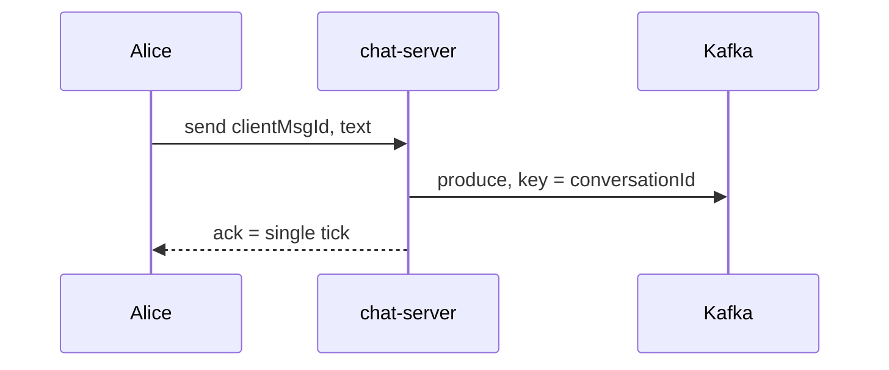

# Documentation with Mermaid

## Rule

All documentation is **Markdown**. For architecture and design visuals, use **Mermaid** diagrams in
the Markdown (not ASCII art, not image files). Follow the `markdown-lint` skill as well.

## When to use which diagram

| Need                             | Mermaid diagram   |
| -------------------------------- | ----------------- |
| Components and how they connect  | `flowchart`       |
| Message flow over time           | `sequenceDiagram` |
| Cassandra tables / entities      | `erDiagram`       |
| State of a message (sent → read) | `stateDiagram-v2` |

## Conventions

- One diagram per concept; readable over exhaustive.
- Label edges with the action (`produce`, `PUBLISH server:server-2`).
- Short node names; detail goes in prose under the diagram.
- Pair every diagram with a sentence or two of context.

## Syntax traps (these break rendering)

- **No `;` in sequence-diagram message text.** It ends the statement, and the rest fails to parse.
  Write `one TX: a + b`, not `TX { a; b }`.
- **Braces and brackets in flowchart labels** need quotes: `A["map {user: server}"]`.
- Check a diagram before committing: paste it into a Mermaid live editor, or parse every block with the
  `mermaid` npm package under jsdom.

## Example

