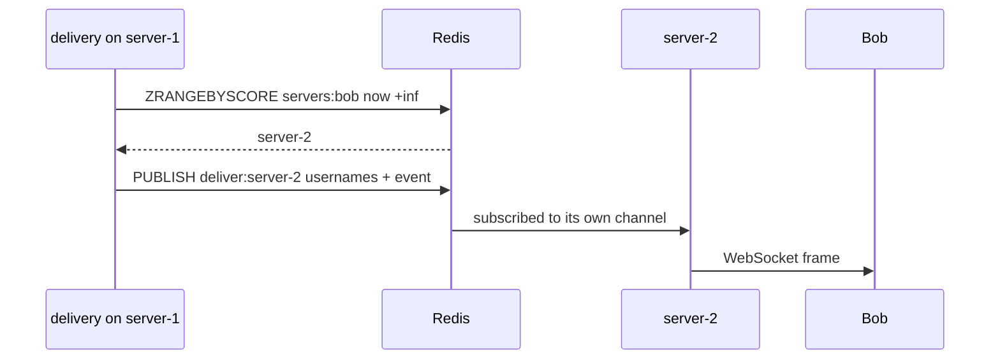
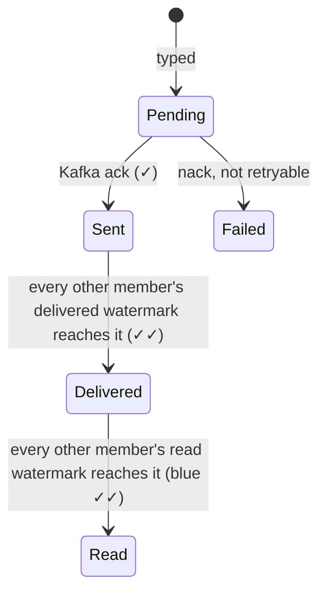

# Decisions (ADRs)

Each record says what was chosen, why, and what was rejected.

## ADR-001 - Stack

Date: 2026-11-06 - Status: Accepted

- **Server:** NestJS 12 on Node 22+, run with `tsx` (no build step). One app, `apps/chat-server`, serves
  REST and (from Task 2) WebSocket and runs the Kafka consumers.
- **Web:** React 19 + Vite 8 + Tailwind 4. No router or state library until a task needs one.
- **Infrastructure:** Cassandra 3.11.9, Kafka 3.5.1 (KRaft), Redis 6.2.24, nginx from Task 3. Everything
  runs from Docker Compose; there is no cloud or Kubernetes target.
- **Clients:** `cassandra-driver` 4.10.0, `@platformatic/kafka` 2.15.0 (pure TypeScript, maintained),
  `redis` 6.3.0.
- **Out of scope:** login, media, end-to-end encryption, observability.

Cassandra 3.11 is the image available here. It has what the design needs: partition and clustering
keys, `TIMEUUID`, TTLs, lightweight transactions and batches. Nothing 4.x/5.x-only is used.

Rejected:

- Socket.IO: it would hide rooms and reconnects, which are what the project is meant to teach.
- Elixir/Phoenix or Go for the gateway: closer to real chat servers, but a new language on top of the
  concepts.
- Postgres for messages: simpler, but Cassandra shows partition-per-conversation modelling directly.
- kafkajs: unmaintained. Confluent's client: native binary.

## ADR-002 - Kafka is the source of truth for messages

Date: 2026-11-06 - Status: Accepted

A send is produced to `chat.messages` with `acks=all` and acknowledged to the sender only then. Two
consumer groups read the topic independently: `persister` writes Cassandra, `delivery` pushes to
connected recipients.

- **No dual write:** Cassandra has no transaction that could include a Kafka publish, so "write the DB,
  then publish" can lose or invent messages. Writing to one place (the log) and deriving the rest avoids it.
- **Ordering:** key = conversation id, so one conversation's messages share a partition and stay in order.
- **Ids:** the server assigns a `TIMEUUID` before producing; Cassandra uses it as the clustering key, so a
  replayed message overwrites the same row.
- **Retention:** `chat.messages` keeps everything (`retention.ms=-1`), so Cassandra can be rebuilt by
  replaying the topic. `chat.receipts` keeps 7 days.
- **Partitions:** 6, enough to show several consumers sharing the work.

Trade-off: history can lag the sender's tick by the persister's delay (milliseconds locally). A client
that reloads at once may miss its own newest message; the client keeps unconfirmed and recent messages
locally (Task 5).

Rejected:

- Write Cassandra first, then Kafka: a crash between the two drops the live delivery.
- Transactional outbox in Cassandra: a logged batch could write the message and an outbox row together,
  but polling and deleting rows makes a queue-shaped table full of tombstones, a known anti-pattern.
- Redis Streams instead of Kafka: fine at this size, but no consumer groups with replay from offset zero
  at Kafka's retention.

## ADR-003 - Local infrastructure and ports

Date: 2026-11-06 - Status: Accepted

- One Compose file, project name `whatsapp-clone`, containers `wa-*`.
- Host ports Kafka 9095 and Redis 6380, so the project runs next to others using the defaults.
- Topics and the keyspace are created by one-shot containers (`kafka-setup`, `cassandra-schema`) that
  are safe to re-run. Kafka auto-creation is off, so a typo in a topic name fails loudly.
- Schema files `infra/cassandra/schema/NNN_*.cql` are applied in name order and use `IF NOT EXISTS`.
  Cassandra has no migration history table; changes are additive (new tables, new columns).
- Redis runs with persistence off: everything in it is rebuilt by clients reconnecting.
- Cassandra heap capped at 512 MB; the image default sizes it from host RAM.
- `stop:pods` keeps volumes; only `reset:pods` deletes data.
- Images are referenced by plain names. A private registry is handled by `infra/retag-images.*`, with
  registry-specific paths in a git-ignored `infra/retag-images.local.json`.

## ADR-004 - Explicit Nest injection tokens

Date: 2026-11-06 - Status: Accepted

`tsx` compiles with esbuild, which does not emit `design:paramtypes` metadata. Nest then injects
`undefined` for class-typed constructor parameters (found when every health check failed with
"Cannot read properties of undefined"). Every constructor parameter uses `@Inject(Token)`.

Rejected: building with `tsc` or SWC for metadata - a build step for no other benefit.

## ADR-005 - Cassandra tables, one per query

Date: 2026-11-06 - Status: Accepted

| Query                        | Table                      | Partition key     | Clustering        |
| ---------------------------- | -------------------------- | ----------------- | ----------------- |
| Does user X exist?           | `users`                    | `username`        | -                 |
| What is conversation C?      | `conversations`            | `conversation_id` | -                 |
| Who is in C? (fan-out list)  | `members_by_conversation`  | `conversation_id` | `username`        |
| My conversations + last text | `conversations_by_user`    | `username`        | `conversation_id` |
| History of C, newest first   | `messages_by_conversation` | `conversation_id` | `message_id` DESC |

- **Direct ids are derived:** `dm:<a>:<b>` with the names sorted. Both sides compute the same id, so
  "start chat" needs no lookup and is idempotent.
- **Message ids are TIMEUUIDs:** time-ordered and unique, assigned by the server before producing.
  Clients compare them by the embedded timestamp (`compareTimeuuid` in `@wa/protocol`), never as strings.
- **Last message per member, fan-out on write:** the persister updates `conversations_by_user` for
  every member, so the list is one partition read. The writes use `USING TIMESTAMP` = the message's
  time, so Cassandra's last-write-wins keeps the newest message even if an older one is replayed later.
- **The list is sorted in the server**, not by a clustering key: a clustering column cannot be updated,
  so ordering by "last activity" would need a delete plus insert per message.
- **Membership changes use a logged batch** (member row + list row), atomic across two partitions.
- **Registration uses `IF NOT EXISTS`** (a lightweight transaction, one Paxos round).
- **Paging:** `LIMIT n+1` tells whether another page exists. `before` reads the natural DESC order;
  `after` uses `ORDER BY message_id ASC`. Responses are always oldest first.

Trade-off: a conversation partition grows without limit. Fine for a demo; production would add a time
bucket (e.g. month) to the partition key and page across buckets.

Rejected: a single `messages` table with a secondary index on sender or conversation - scatter-gather
reads across every node.

## ADR-006 - Idempotent send with a client message id

Date: 2026-11-06 - Status: Accepted

The client generates `clientMsgId` (a UUID) before sending and reuses it on every retry. The server
claims `dedupe:<sender>:<clientMsgId>` in Redis with `SET NX EX 86400` before producing:

- Claimed: produce, then store the ack under the key. A failed produce deletes the key, so the retry
  can produce.
- Already claimed with an ack: return the same ack; nothing is produced again.
- Already claimed, still in flight: 409, the client retries shortly.

Even if Redis forgets the key, the duplicate would be a new `messageId`, and clients key messages by
`sender:clientMsgId`, so the UI still shows one bubble.

Rejected: a lightweight transaction on a Cassandra `client_msg_id` table - a Paxos round on every send,
and Cassandra is written by the persister, not the send path (ADR-002).

## ADR-007 - No login: the caller names itself

Date: 2026-11-06 - Status: Accepted

REST calls carry `x-username`; the WebSocket sends the username as its first message (Task 2). The
server checks only that the user exists and is a member of the conversation. This is fine on one
machine and unsafe anywhere else; a real deployment would use OIDC tokens and take the identity from
the verified `sub` claim.

## ADR-008 - WebSocket protocol

Date: 2026-11-06 - Status: Accepted

Plain `ws` on the HTTP server's port at `/ws`, JSON frames with a `type` field, validated with Zod
(`@wa/protocol`, shared by server and web).

| Direction       | Frames                                                                      |
| --------------- | --------------------------------------------------------------------------- |
| client → server | `hello` (first frame, names the user), `send`                               |
| server → client | `ready`, `ack` (single tick), `nack` (with `retryable`), `message`, `error` |

- **Order per socket:** frames from one socket are handled one after another, so two quick sends reach
  Kafka in the order they were typed. Without it, both sends race through the membership check and
  Redis and can swap.
- **Close codes** 4000 (frame before hello), 4001 (unknown user), 4002 (no hello within 5 s). 1001 on
  shutdown tells clients to reconnect.
- **Heartbeat:** the server pings every 15 s, below the usual 60 s proxy idle timeout; a socket that
  has not answered the previous ping is terminated. Browsers answer pings automatically.
- **REST fallback:** `POST /conversations/:id/messages` runs the same `MessagesService.send`, so a client
  can send while its socket reconnects.
- **Delivery group starts at `latest`:** a brand-new group would otherwise push the whole history to
  whoever is online. Once it has committed offsets it resumes where it stopped.

Rejected: Nest's `@WebSocketGateway` - it wraps frames as `{event, data}` and hides the socket
lifecycle that this project is meant to show. Socket.IO - see ADR-001.

## ADR-009 - Short Kafka consumer session timeouts

Date: 2026-11-06 - Status: Accepted

Found in testing: after a server was killed (no clean shutdown), the restarted server's `persister`
group took 47 s to get its partitions. The broker kept waiting for the dead member until the session
timeout (client default 60 s, rebalance timeout 102 s). The new `delivery` group, which had no dead
member, joined at once - so for 47 s messages were delivered live but not stored.

Consumers now use `sessionTimeout` 10 s, `rebalanceTimeout` 15 s, `heartbeatInterval` 1 s. Measured
after a kill: both groups consume 3 s after the restarted server is healthy.

Trade-off: a member that pauses more than 10 s (long GC, debugger breakpoint) is dropped and the group
rebalances. Records are processed one at a time in milliseconds, so this does not happen in practice.

## ADR-010 - Routing and presence in Redis

Date: 2026-11-06 - Status: Accepted

With two servers, the `delivery` consumer that reads a message (any server in the group) is usually
not the server holding the recipient's socket.

- **`servers:<user>` is a sorted set**, member = server id, score = expiry time. Each server refreshes
  its users every 15 s with a 45 s expiry and removes expired members. A plain set with one key TTL
  would keep a crashed server listed for as long as another server keeps refreshing the key.
- **One pub/sub channel per server** (`deliver:<serverId>`), so a server only receives events for its
  own users. The lookup for a group is one pipelined round trip.
- **Presence is derived:** online = any unexpired server entry. Going offline writes
  `lastseen:<user>` and publishes on `presence`; every server forwards it to sockets that sent a
  `watch` frame for that user. Joining publishes online only if the user was offline everywhere.
- **Registered before `ready`:** the hello handler awaits the Redis entry, so a push sent right after
  `ready` finds the server.
- **Fire-and-forget:** pub/sub stores nothing. A server that is restarting, or a socket that is
  reconnecting, misses the push; the client recovers it from Cassandra on reconnect (Task 5).
- **nginx round robin** for both HTTP and WebSocket, `proxy_next_upstream` for a dead server, and
  `proxy_read_timeout 60s`, above the 15 s server ping.

Measured: after a hard kill of server-2, the client reconnected through nginx to server-1 and received
the next message; server-2's stale entry aged out 40 s later.

Trade-off: when a server crashes, its users look online to watchers until their entries expire
(up to 45 s), and no `offline` event is sent for users who never reconnect.

Rejected:

- Sticky sessions (`ip_hash`) instead of routing: on one machine every tab has the same IP, so all of
  them would land on one server, and routing would still be needed after a failover.
- Broadcasting every message to every server: simple, but each server then reads every message, which
  does not scale with the number of servers.
- Kafka per-server topics: durable, but a topic per server is heavy, and a push is worthless after a
  few seconds anyway.

## ADR-011 - Receipts are watermarks

Date: 2026-11-06 - Status: Accepted

A receipt says "I have everything up to message X" (`delivered`) or "I have read everything up to X"
(`read`). It is not "I read message X".

- **Storage is one row per member** (`read_state`), not one per message and reader: a 256-member
  group stays at 256 rows however many messages it has.
- **Forward only, without reading first:** the receipts consumer writes `USING TIMESTAMP` = the
  watermark message's own time. A late or replayed receipt for an older message has an older timestamp
  and loses. `read` also writes `delivered_up_to`; each cell keeps its own newest value.
- **Ordered with the messages:** `chat.receipts` uses the conversation id as key, like `chat.messages`.
- **The sender has read their own message:** the persister moves the sender's read watermark, so a
  message never counts as unread for the person who wrote it (needed for unread counts, Task 7).
- **Clients send** `delivered` as soon as a message reaches the device (live or history) and `read`
  only while the conversation is open and the tab visible, batched over 200 ms and only when the
  watermark moves.
- **Ticks are computed in the browser** from the members' watermarks (`apps/web/src/ticks.ts`); the
  tooltip lists who has read it, who has it, who is still waiting.

## ADR-012 - Typing indicators skip Kafka and Cassandra

Date: 2026-11-06 - Status: Accepted

A typing event is worthless a few seconds later, so it goes from the gateway straight to the router
(Redis pub/sub) and is never stored. The client sends at most one per conversation every 2 s; the
server drops extras with the same limit; receivers show it for 4 s and drop it when a message from that
person arrives.

Found in the UI test: right after sending, the next keystrokes were inside the 2 s throttle window, so
the other side saw nothing. Sending a message now resets the throttle on both client and server.
