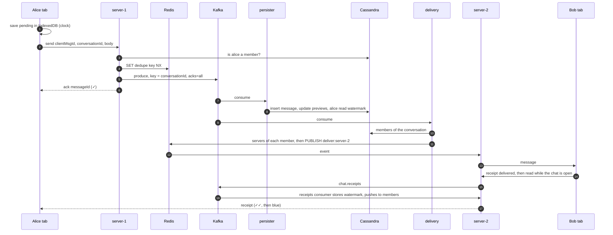

# Interview Questions — Mini WhatsApp

System-design questions drawn from this project, easiest first. Answers describe what the code
actually does; `ADR-0xx` points to [DECISIONS.md](DECISIONS.md) for the full reasoning and the
rejected options.

- [Level 1 — Foundations](#level-1--foundations)
- [Level 2 — Building blocks](#level-2--building-blocks)
- [Level 3 — Control flow: sending a message](#level-3--control-flow-sending-a-message)
- [Level 4 — Reliability and consistency](#level-4--reliability-and-consistency)
- [Level 5 — Trade-offs](#level-5--trade-offs)
- [Level 6 — Scenarios](#level-6--scenarios)
- [Level 7 — Design extensions](#level-7--design-extensions)
- [Definitions — quick answers](#definitions--quick-answers)

---

## Level 1 — Foundations

### 1. What are the components, and what does each own?

| Component   | Owns                                                              |
| ----------- | ----------------------------------------------------------------- |
| nginx       | Spreads HTTP and WebSocket connections over the chat servers      |
| chat-server | Sockets, REST API, producing to Kafka, the three consumer groups  |
| Kafka       | The message log, ordered per conversation, kept forever           |
| Cassandra   | Read model: history, conversation lists, members, read watermarks |
| Redis       | Ephemeral state: user → servers, presence, typing, send dedupe    |
| Browser     | UI, local history and outbox in IndexedDB                         |

### 2. Why WebSocket and not HTTP polling?

The server must push a message the moment it exists. Polling either wastes requests (most return
nothing) or adds latency (the poll interval). A WebSocket is one long-lived connection both sides can
write to. Task 1 polled every 3 s; Task 2 replaced it and delivery dropped to about 20 ms.

### 3. Why can't one server do it all?

One process holds a limited number of sockets and is a single point of failure. With two servers
behind nginx, alice and bob are usually on different processes, which creates the core problem of a
chat system: how does server-1 get a message to a socket held by server-2? (Q11.)

### 4. What does each tick mean?

✓: Kafka acknowledged the write (the server has it). ✓✓: every other member's device has it.
Blue ✓✓: every other member has read it. A clock means not yet acknowledged; it stays in the outbox.

### 5. How is a conversation id chosen?

1:1 chats use `dm:<a>:<b>` with the two usernames sorted, so both sides compute the same id without a
lookup and "start chat" is idempotent. Groups get `grp:<uuid>`.

---

## Level 2 — Building blocks

### 6. Why is Kafka the source of truth instead of Cassandra?

Cassandra has no transaction that could also cover a Kafka publish, so "write the DB, then publish"
can store a message nobody is told about, or publish one that was never stored. Here a send is one
write to one place (the log). Cassandra and live delivery are both consumers of it and can each fall
behind or be rebuilt (ADR-002). `pnpm db:rebuild` empties the message table and replays it.

### 7. Why key Kafka records by conversation id?

Kafka orders records only within a partition, and one key always goes to one partition. All
messages and receipts of a conversation are therefore processed in order. Keying by sender would
interleave two people's messages arbitrarily.

### 8. What is a consumer group, and why are there three?

A group shares a topic's partitions among its members and tracks its own offsets. `persister`
(writes Cassandra), `delivery` (pushes to sockets) and `receipts` (stores watermarks, pushes ticks)
each read independently, so a slow Cassandra does not delay pushes, and a new group can start from
offset 0.

### 9. How are the Cassandra tables designed?

One table per query (ADR-005): history is `messages_by_conversation` (partition = conversation,
clustering = TIMEUUID descending), the list is `conversations_by_user` (partition = user), members are
`members_by_conversation`, watermarks are `read_state`. Data is duplicated on purpose; there are no
joins.

### 10. Why TIMEUUIDs for message ids?

They are unique without coordination and sortable by time, so they are the clustering key and the
paging cursor at once. Their string form does not sort by time, so clients compare them with
`compareTimeuuid`, which reads the embedded 60-bit timestamp.

### 11. How does a message get from server-1 to a socket on server-2?

`servers:<user>` in Redis is a sorted set of server ids scored by expiry. The delivery consumer looks
up every recipient in one pipeline and publishes once per server on `deliver:<serverId>`; each server
subscribes only to its own channel (ADR-010).

### 12. How does presence work?

A user is online while any server has an unexpired entry for them. Servers refresh their users every
15 s with a 45 s expiry. When a user's last socket closes, the server writes `lastseen:<user>` and
publishes on `presence`; servers forward that to sockets that sent a `watch` frame.

---

## Level 3 — Control flow: sending a message

### 13. Walk through a message from Enter to blue ticks

1. **Before the network:** the tab shows the message with a clock and writes it to IndexedDB, so a
   reload or crash cannot lose it.
2. **Send:** over the WebSocket (REST if the socket is down). The server checks membership, claims the
   `clientMsgId` in Redis, assigns a TIMEUUID and produces with `acks=all`.
3. **Ack:** only after Kafka confirmed. The clock becomes ✓.
4. **Persist and deliver** run in parallel in two consumer groups.
5. **Receipts** are watermarks, also through Kafka, keyed by conversation.

### 14. What happens to frames sent quickly from one socket?

They are handled one after another (a promise chain per socket). Without it, two sends race through
the membership check and Redis and can reach Kafka swapped (ADR-008).

### 15. What does the client do after reconnecting?

It fetches the conversation list, then for every conversation whose last message is past its local
cursor it pages `after=<cursor>` until done, then resends the outbox with the same `clientMsgId`s,
then sends delivered receipts (ADR-013).

---

## Level 4 — Reliability and consistency

### 16. How is a retried send stored only once?

The client reuses its `clientMsgId` on every attempt. The server's `SET dedupe:<sender>:<id> NX`
claims it before producing; a retry finds the stored ack and returns it. A failed produce deletes the
claim. A claim still in flight returns 409 and the client retries later (ADR-006).

### 17. Is delivery exactly-once?

No: at-least-once everywhere, made to look exactly-once by idempotency. Cassandra writes are upserts
by primary key; clients key messages by `sender:clientMsgId`; watermarks only move forward. The test
of a 30-message burst plus a retry showed one copy each.

### 18. What if the Redis pub/sub push is lost?

Nothing is lost, only late. Pub/sub stores nothing, so a server restarting or a socket reconnecting
misses the push. The message is in Kafka and Cassandra, and the client's next sync fetches everything
after its cursor.

### 19. Why does the sync cursor not move on a live push?

The cursor means "everything up to here, with no gap". A live push can arrive after an earlier push
was dropped; moving the cursor past it would skip the dropped one forever.

### 20. How can a watermark be forward-only without reading it first?

Every cell in Cassandra keeps a write timestamp and the newest wins. The receipts consumer writes with
`USING TIMESTAMP` = the watermark message's own time, so an older receipt, replayed or late, has an
older timestamp and loses automatically (ADR-011).

### 21. What breaks if a consumer handler throws?

It is retried with backoff until it succeeds; the record is not committed meanwhile. Skipping would
lose a message, because the log is the truth. Only an unparseable record is logged and skipped.

---

## Level 5 — Trade-offs

### 22. Why per-member watermarks instead of a row per message per reader?

A 256-member group with a million messages would need 256 million receipt rows; watermarks need 256.
"Read by" for a message is derived: every member whose `read_up_to` is at or after it.

### 23. Fan-out on write or on read for groups?

On read of the log: one stored copy per message; the delivery consumer pushes once per member. A
per-user inbox (fan-out on write) would make sync one partition read per user but multiply writes by
group size (ADR-015).

### 24. Why a sorted set for user → servers and not a key with a TTL?

Each server's entry must expire on its own. With one set and one key TTL, a crashed server stays
listed as long as another server keeps refreshing the key for the same user.

### 25. Why not sticky sessions?

On one machine every tab has the same IP, so `ip_hash` would put all of them on one server; and after
a failover, routing is needed anyway (ADR-010).

### 26. Why does typing skip Kafka?

It is worthless seconds later. Storing it would cost writes for nothing, so it goes straight through
Redis pub/sub, throttled to one per 2 s (ADR-012).

### 27. What did you give up by acking before Cassandra has the message?

History can lag the ack by the persister's delay (milliseconds; seconds after a restart). A device
that reloads at once may not see its newest message from the server, which is why the client keeps
its own copy in IndexedDB.

---

## Level 6 — Scenarios

### 28. A chat server is killed. What does the user see?

Their socket closes (code 1006). The client waits a random time up to an exponential cap and
reconnects through nginx to the survivor, which registers them in Redis. Measured: delivery worked
again on the next message; the dead server's Redis entry aged out in about 40 s. Meanwhile watchers
may still see the user as online (ADR-010).

### 29. After a restart, messages are pushed but not stored for almost a minute. Why?

This happened: the killed server's consumer was still a group member, and the broker waited for its
session to time out (60 s by default) before giving the partitions to the new process. The new
`delivery` group had no dead member and joined at once. Fix: 10 s session timeouts; both groups now
consume 3 s after a restart (ADR-009).

### 30. The phone loses its network. Why doesn't the app notice?

A dead network does not close a TCP connection for minutes, and page JavaScript cannot see WebSocket
pings. Chrome kept the socket `OPEN` in testing. The client now closes the socket on the browser's
`offline` event; the server drops it after one missed ping (ADR-014).

### 31. A user says "I typed right after sending, and the other side never saw typing…"

Both throttles (client and server) still counted the keystrokes before the send. The recipient had
cleared the indicator when the message arrived, so nothing showed for 2 s. Sending now resets the
throttle (ADR-012).

### 32. Cassandra lost the messages table. Can you recover?

Yes: `chat.messages` keeps everything. `pnpm db:rebuild` truncates the table and starts a process with
a new persister group, which starts at offset 0. Measured: 512 messages back in 12 s. The writes are
upserts with message-time timestamps, so the running persister and the rebuild can overlap safely.

### 33. A group admin leaves. Who manages the group?

If no admin remains, the alphabetically first remaining member is promoted, and the system message
says so ("alice left; bob is now an admin").

---

## Level 7 — Design extensions

### 34. How would you scale to millions of connections?

Separate the gateway (sockets only) from the consumers, scale gateways on connection count and
consumers on Kafka lag, raise the partition count, and shard Redis by user. Replace the per-message
member lookup with a cached member list invalidated by the membership system messages.

### 35. How would you add end-to-end encryption?

Signal protocol: per-device identity and prekeys published to the server; 1:1 messages encrypted with
the Double Ratchet; groups with sender keys. The server stores and routes ciphertext only, so
previews and server-side unread counts of text go away; ids, timestamps and watermarks stay.

### 36. How would you add push notifications for offline users?

A fourth consumer group on `chat.messages`: for members with no unexpired `servers:` entry, send to
FCM/APNs with a collapse key per conversation, rate-limited per device.

### 37. What would you change before production?

Real authentication (OIDC, identity from the token, ADR-007); TLS; Kafka and Cassandra with RF 3;
time-bucketed message partitions; message size and rate limits per user; a dead-letter topic for
unparseable records; metrics on consumer lag, fan-out time and reconnect rates.

---

## Definitions — quick answers

**D1. WebSocket?** A full-duplex connection upgraded from HTTP; both sides send frames at any time.
Here at `/ws`, JSON frames with a `type` field.

**D2. Heartbeat?** A periodic ping to detect dead connections and keep proxies from closing idle ones.
The server pings every 15 s and terminates a socket that missed the previous ping.

**D3. Close code?** The number sent when a WebSocket closes. 1000 normal, 1001 going away, 1006
abnormal (no close frame); 4000-4999 are for applications (4000 frame before hello, 4001 unknown user,
4002 no hello).

**D4. Partition key / clustering key?** The partition key picks the node and the partition (here the
conversation); the clustering key orders rows inside it (here the TIMEUUID, newest first).

**D5. TIMEUUID?** A version-1 UUID that embeds a 60-bit timestamp: unique and time-ordered.

**D6. Lightweight transaction?** `IF NOT EXISTS` / `IF` conditions in Cassandra, run with Paxos: used
for registration so two tabs cannot both create "bob".

**D7. `USING TIMESTAMP`?** Sets a write's timestamp explicitly; Cassandra's last-write-wins then keeps
the value with the newest timestamp, which makes forward-only updates free.

**D8. Logged batch?** Several statements, possibly across partitions, that all apply or none do. Used
for "member row + list row"; not a bulk-load speed-up.

**D9. Tombstone?** The marker a delete leaves in Cassandra until compaction. Queue-shaped tables that
insert and delete constantly fill with them, which is why there is no outbox table here.

**D10. Consumer group / offset / lag?** A group shares partitions among members; the offset is how far
it has read; lag is the newest offset minus the committed one.

**D11. Session timeout?** How long a broker waits without heartbeats before removing a group member
and rebalancing. 10 s here (ADR-009).

**D12. `acks=all` / idempotent producer?** The broker confirms only when every in-sync replica has the
record; idempotence stops the client's own retries from writing twice.

**D13. Pub/sub?** Fire-and-forget broadcast to current subscribers. Nothing is stored, so offline
subscribers miss it.

**D14. Fan-out?** Turning one message into one delivery per recipient.

**D15. Watermark?** "Everything up to X": one value per member instead of one record per message.

**D16. Idempotency key?** A client-chosen id (`clientMsgId`) that makes retries of the same request
return the first result.

**D17. Outbox (client)?** Messages typed but not acknowledged, kept in IndexedDB and resent in order
after reconnect.

**D18. Exponential backoff with full jitter?** Wait `random(0, min(cap, base × 2^attempt))`. Jitter
spreads clients out so a restarted server is not hit by everyone at the same instant.

**D19. Thundering herd?** Many clients doing the same thing at the same moment, e.g. reconnecting
after an outage. Full jitter is the defence.

**D20. Offline-first?** The app reads and writes local storage first and syncs with the server when
it can.

**D21. Presence?** Whether a user is online, and when they were last seen; derived here from Redis
entries with expiry.

**D22. Eventual consistency?** Derived stores converge after a delay: Cassandra lags Kafka, unread
counts lag receipts, presence lags a crash.

**D23. Read model?** Data shaped for queries and derived from the source of truth; Cassandra here.

**D24. Log compaction vs retention?** Retention deletes by age; compaction keeps the newest record per
key. `chat.messages` uses neither (`retention.ms=-1`), because every message matters, not just the
latest per conversation.

**D25. Upgrade (HTTP)?** The `Connection: upgrade` / `Upgrade: websocket` handshake. nginx must pass
those headers on (`proxy_set_header Upgrade`) or WebSockets fail behind it.
