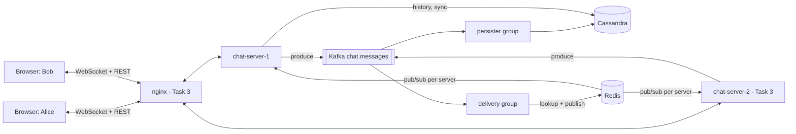
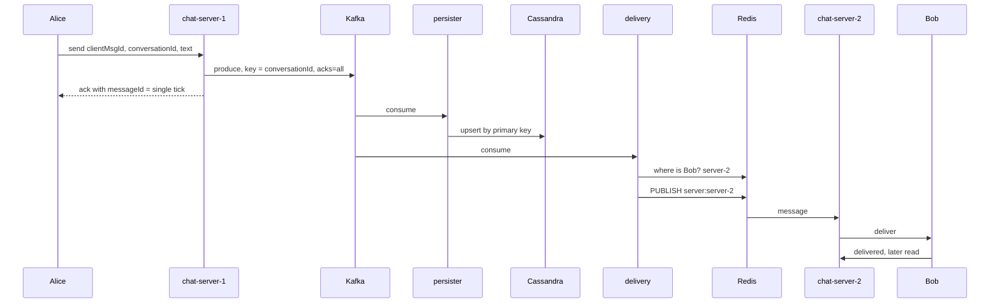

# Architecture

Target design. Parts not built yet are marked with the task that adds them (see [TASKS.md](TASKS.md)).

## 1. Components

| Part        | Owns                                                                      |
| ----------- | ------------------------------------------------------------------------- |
| chat-server | WebSocket connections, REST API, producing to Kafka, both consumer groups |
| Kafka       | The message log: ordered per conversation, kept forever, replayable       |
| Cassandra   | Read model: history and conversation lists, one table per query           |
| Redis       | Ephemeral state: which server holds which user, presence, typing          |
| web         | UI, local history (IndexedDB, Task 5)                                     |

Both consumer groups run inside chat-server to keep the project small. In production they would be
separate deployments, scaled on their own.

## 2. Sending a message

The sender gets its tick once Kafka has the message, before Cassandra does. Cassandra and live delivery
are both consumers of the log, so either can fall behind or crash without losing a message (ADR-002).

## 3. Data placement

| Data                    | Store                 | Why                                    |
| ----------------------- | --------------------- | -------------------------------------- |
| Messages (truth)        | Kafka `chat.messages` | Ordered, durable, replayable           |
| Messages (read model)   | Cassandra             | Paged history per conversation         |
| Conversation list       | Cassandra             | Per-user query, denormalised           |
| Receipts                | Kafka `chat.receipts` | Fan back to the sender (Task 4)        |
| User → server, presence | Redis with TTL        | Lost on restart, rebuilt by reconnects |
| Typing                  | Redis pub/sub only    | Worthless a few seconds later          |
